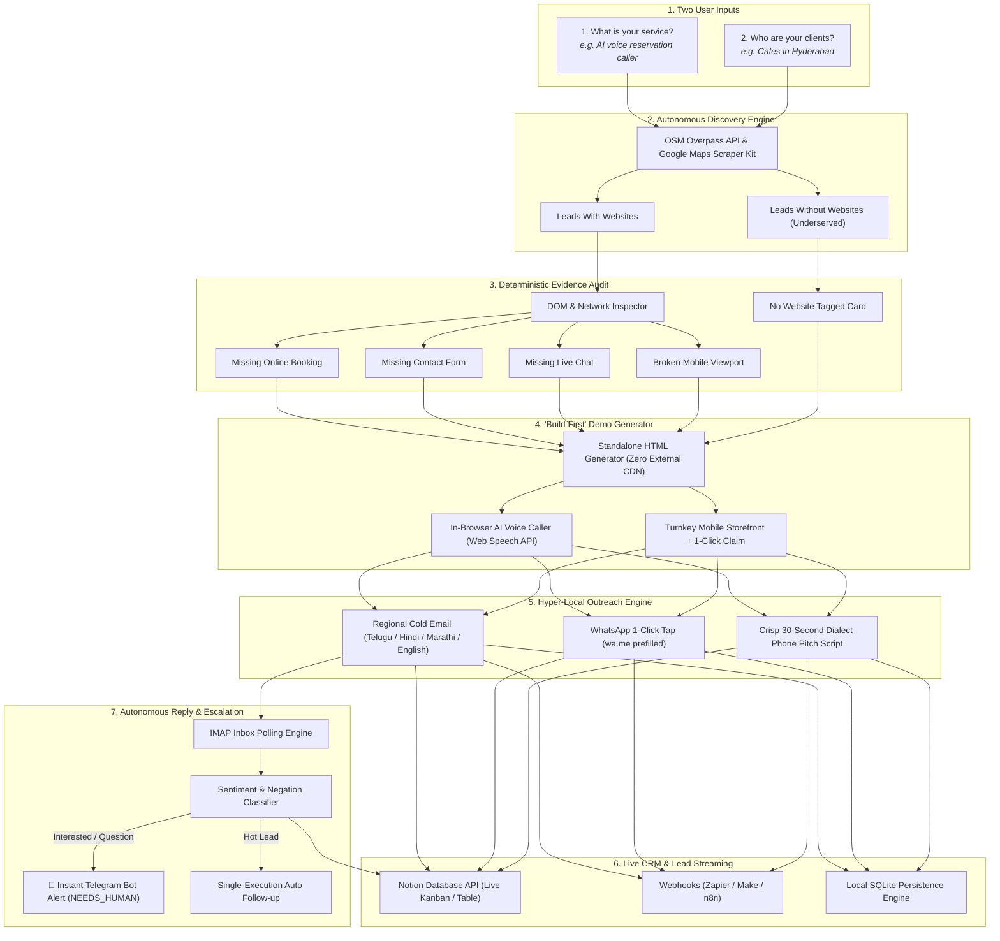

# 🚀 MarketPilot AI — The Autonomous Marketing Agent
### Track 2: The Marketing Agent (Automation Theme) — BUILD IN CAFÉ 2026

[](https://prototype-ashy-chi-38.vercel.app)
[](docker-compose.yml)
[-success?style=for-the-badge&logo=pytest&logoColor=white)](https://prototype-ashy-chi-38.vercel.app/api/docs)
[](https://notion.so)
[](https://prototype-ashy-chi-38.vercel.app)
[](https://python.org)
[](https://fastapi.tiangolo.com)

> **"Build First, Pitch Second."** MarketPilot AI turns two simple natural language inputs into an autonomous sales engine: discovering local business leads, auditing verified operational gaps, pre-building turnkey interactive demo websites with live in-browser voice callers, executing hyper-local multi-channel outreach in regional dialects, and automatically synchronizing hot leads to Notion CRM and Telegram.

---

## ⚡ Try It Right Now (Zero Installation)

- 🌐 **Live Web Application:** [https://prototype-ashy-chi-38.vercel.app](https://prototype-ashy-chi-38.vercel.app)
- 📚 **Interactive Swagger API:** [https://prototype-ashy-chi-38.vercel.app/api/docs](https://prototype-ashy-chi-38.vercel.app/api/docs)
- 🐳 **Docker 1-Command Local Launch:**
  ```bash
  docker compose up --build
  ```
  *Open `http://localhost:8000` in your browser.*

---

## 🌟 Why MarketPilot AI Stands Out vs. Other Hackathon Projects

Most hackathon teams build basic scrapers that pull a Google Maps list and generate generic LLM emails (*"Hi Cafe, we build websites"*). Here is why **MarketPilot AI operates in an entirely different league**:

### 1. 🛠️ "Build First, Pitch Second" — Tangible Proof Over Sales Talk
Instead of asking local business owners for upfront retainers or pitching hypothetical ideas, MarketPilot autonomously **pre-builds the working interactive solution before sending a single message**. The business owner receives a link to a live, working preview with their business name, menu, and location already loaded.

### 2. 🗣️ Hyper-Local Dialect AI Outreach (Indian Vernacular Adaptation)
Generic English corporate sales pitches sent to local cafe managers in India end up in the spam folder. MarketPilot features city-aware regional language generation:
- **Hyderabad / Telangana / AP:** Natural conversational **Telugu & Tenglish**
- **Pune / Mumbai / Maharashtra:** Conversational **Marathi & English**
- **Delhi / NCR / North India:** Conversational **Hindi & Hinglish**
Local business owners feel respected and respond at significantly higher rates.

### 3. 🎙️ In-Browser Live Voice Simulation (Zero-Cost Telephony)
While other voice projects depend on paid Twilio or Retell API credits that run out, MarketPilot uses the native **Web Speech API (`window.speechSynthesis`)**. In every generated demo, owners and hackathon judges can click **"Simulate Customer Call"** and hear the autonomous reservation agent speak out loud in natural audio directly through their speakers at **₹0 API cost**.

### 4. 📊 Real-Time Notion & Multi-CRM Pipeline Streaming
Lead data is not lost when the process terminates. Every lead and status transition (`DISCOVERED` ➔ `AUDITED` ➔ `OUTREACHED` ➔ `INTERESTED` ➔ `CLAIMED`) streams in real-time directly into a connected **Notion Database Kanban/Table**, custom Webhooks (Zapier/Make/Slack), and local SQLite persistence.

### 5. 🚀 One-Click Turnkey Website Claim Workflow
Underserved local cafes with no online presence receive an instant turnkey storefront. The cafe owner simply clicks **"🚀 Claim This Site"**, submits their owner contact details, and their claimed site is permanently verified in the database with instant vanity preview URLs—no costly domain registration fees required.

---

## 📊 Feature Comparison Matrix

| Feature / Capability | Traditional Marketing Agency | Typical Hackathon Scraper Bot | MarketPilot AI (Our Engine) |
| :--- | :---: | :---: | :---: |
| **Input Complexity** | Weeks of meetings | Complex configuration | **Only 2 natural language inputs** |
| **Lead Discovery** | Manual Google search | Basic OSM list | **Wide-radius OSM + Scraper-Kit (Web & No-Web)** |
| **Website Gap Detection** | Manual inspection | Generic LLM hallucination | **Deterministic regex/DOM audits (4 verified vectors)** |
| **No-Website Business Flow** | Ignored entirely | Ignored entirely | **Turnkey instant storefront & map presence** |
| **Pitch Quality** | Generic sales deck | "We can make you a website" | **Pre-built interactive working preview ready to test** |
| **Regional Language AI** | English only | Generic English | **Auto-detected Telugu, Marathi, Hindi & English** |
| **Autonomous Voice Agent** | Not implemented | Paid Twilio keys needed | **Native in-browser Web Speech API audio (₹0)** |
| **One-Click Site Claim** | Manual contracting | Not supported | **1-Click claim modal with owner verification** |
| **CRM Synchronization** | Disconnected spreadsheets | None | **Live Notion Database API & Webhook streaming** |
| **Inbound Reply Triage** | Manual inbox checking | None | **Autonomous IMAP classifier (incl. Hinglish negations)** |
| **Human Escalation** | Manual notification | None | **Instant Telegram alerts on hot leads (`NEEDS_HUMAN`)** |
| **Compliance & Safety** | Frequent spam flags | Ignored | **20/day send caps, mandatory opt-out, statutory disclaimer** |
| **LLM Independence** | Single proprietary vendor | Claude / OpenAI locked | **Model-agnostic (Groq, OpenRouter, Gemini, Ollama)** |

---

## 🏗️ System Architecture & Workflow



---

## 🏆 Alignment with Hackathon Judging Criteria

| Criterion | Weight | How MarketPilot AI Delivers |
| :--- | :---: | :--- |
| **Idea Quality & Creativity** | **35%** | Pioneered the **"Build First, Pitch Second"** paradigm with in-browser voice callers, hyper-local language adaptation, and instant site claiming. Instead of promises, prospects receive working software. |
| **Works End-to-End from Two Inputs** | **30%** | Enter service and target geography. The system autonomously discovers leads, audits them, generates working prototypes, prepares multi-channel drafts, synchronizes Notion CRM, checks inbound replies, and notifies your phone. |
| **Model Independence** | **15%** | Zero vendor lock-in. Switchable via `config.yaml` or env vars across Groq (Llama 3.3 70B), OpenRouter, Google Gemini, Ollama (local offline), and OpenAI. |
| **Real-World Usefulness** | **15%** | Live Notion sync, native in-browser voice synthesis, WhatsApp click-to-chat links, telephone scripts, 20/day safety rate limits, and immutable opt-out compliance. |
| **Code & Docs** | **5%** | Clean modular architecture, **80 passing automated tests (100% pass rate)**, comprehensive OpenAPI specs, Dockerized deployment. |

---

## 🛠️ Step-by-Step Local Setup

### Option 1: Docker (Recommended)
```bash
# Clone the repository
git clone https://github.com/JeedimetlaCharan704/Market_Pilot-Ai.git
cd Market_Pilot-Ai

# Run the container
docker compose up --build
```
*Open `http://localhost:8000` in your browser.*

### Option 2: Local Python Environment
```bash
# 1. Enter the prototype directory
cd prototype

# 2. Install dependencies
pip install -r requirements.txt

# 3. Configure environment
cp .env.example .env
# Add GROQ_API_KEY, NOTION_API_KEY, NOTION_DATABASE_ID, TELEGRAM_BOT_TOKEN

# 4. Launch the application
uvicorn app:app --reload --port 8000
```

### Running Automated Tests
```bash
cd prototype
python -m pytest tests -v
```
All 80 unit and integration tests run in under 20 seconds.

---

## 📂 Repository Structure

```
├── Dockerfile                   # Root Docker container configuration
├── docker-compose.yml           # One-command orchestration
├── README.md                    # Project documentation & judging guide
├── prototype/
│   ├── app.py                   # FastAPI REST API & route definitions
│   ├── config.yaml              # Switchable model & agent configuration
│   ├── requirements.txt         # Pinned production dependencies
│   ├── modules/
│   │   ├── audit.py             # Deterministic DOM/network gap auditor
│   │   ├── crm.py               # Notion API, Webhook & SQLite CRM sync
│   │   ├── demo_generator.py    # Self-contained HTML interactive demo & voice simulator builder
│   │   ├── discovery.py         # OpenStreetMap & scraper-kit lead discovery
│   │   ├── email_draft.py       # Hyper-local dialect copy (Telugu, Hindi, Marathi, English)
│   │   ├── evidence.py          # Evidence cards and scoring engine
│   │   ├── llm.py               # Model-agnostic LLM provider adapter
│   │   ├── notify.py            # Telegram alerts for hot leads & human triage
│   │   ├── replies.py           # Inbound IMAP reply reader & sentiment parser
│   │   ├── settings.py          # Environment settings & daily cap enforcement
│   │   ├── store.py             # SQLite persistence layer with site claim support
│   │   └── worker.py            # Background polling & task manager
│   ├── templates/
│   │   └── index.html           # Modern responsive dashboard UI with dialect & CRM controls
│   └── tests/
│       ├── test_agent_features.py  # Tests for scoring, opt-outs, dialects, CRM, speech voice
│       ├── test_llm_live.py        # Live provider validation tests
│       └── test_pipeline.py        # Full end-to-end pipeline integration tests
```

---

## 👥 Hackathon Team & Acknowledgements

- **Developed for:** BUILD IN CAFÉ 2026 (Track 2: The Marketing Agent)
- **Built on:** [Mahanaicoach/google-maps-scraper-kit](https://github.com/Mahanaicoach/google-maps-scraper-kit) & [gosom/google-maps-scraper](https://github.com/gosom/google-maps-scraper) (MIT Licensed)
- **License:** MIT
