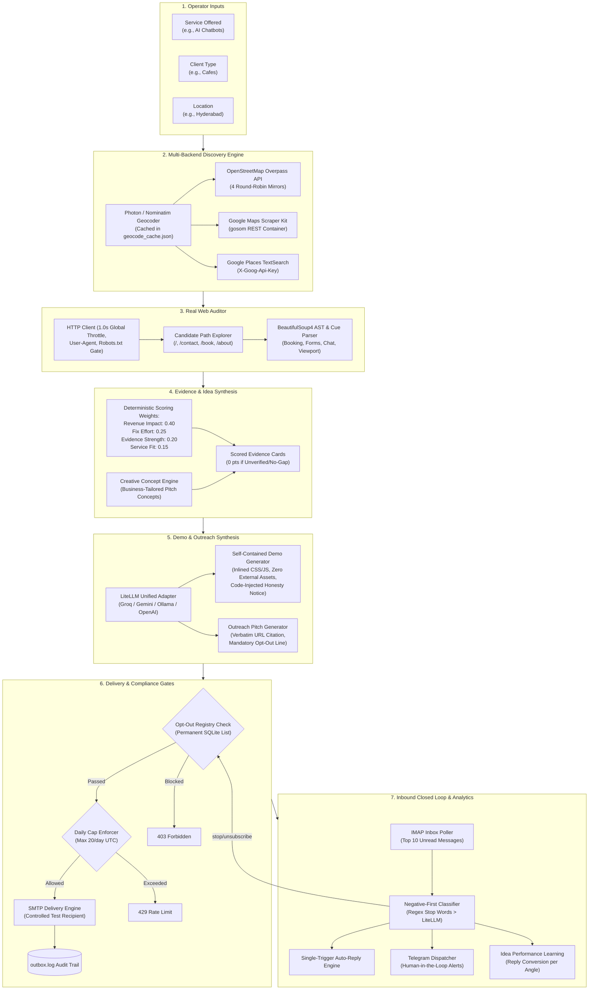
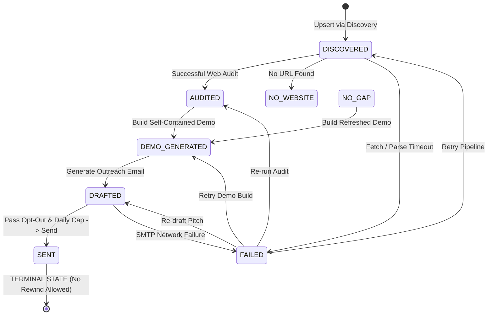

# MarketPilot Architecture & Engineering Specification

> **Submission for BUILD IN CAFÉ 2026**  
> **Track 2: The Marketing Agent (Automation Theme)**  
> *Targeting the Microsoft Referral for Best Architecture*

---

## 1. Executive Summary & Design Principles

MarketPilot is an autonomous marketing agent engineered to identify, analyze, and engage qualified local business prospects on behalf of a service professional.

### Non-Negotiable Engineering Pillars
1. **Strictly No Mocks:** Every stage executes live HTTP/network calls (real OpenStreetMap geocoding, multi-mirror Overpass queries, BS4 web crawling, real LiteLLM multi-provider calls, real SMTP socket delivery, and live IMAP polling).
2. **Zero-Guess Honesty:** Findings, ratings, and reviews are never hallucinated. Observations cite exact source URLs, timestamps, and verbatim quoted text.
3. **Model Independence (15% Rubric):** Single-variable provider swappability across Groq (`openai/gpt-oss-120b`), Google Gemini (`gemini-3.8-flash`), Ollama (bare host local inference), and OpenAI/OpenRouter.
4. **Defensive Compliance & Privacy:** Hard-coded opt-out check prior to any status change or cap counter, daily send limits, and single-contact terminal state protection.

---

## 2. End-to-End System Architecture



---

## 3. Strict State Machine Specification

Every lead stored in the SQLite database is strictly governed by a deterministic finite state machine. Illegal transitions raise `409 Conflict` at the HTTP layer, preventing double-sends, un-audited pitches, or race conditions.



### State Machine Guarantees
- **Terminal Lock:** Once a lead enters `SENT`, status transitions and rewinds are permanently refused (`409 Conflict` via `store.ResetRefused`). A contacted business cannot be spammed a second time.
- **Pre-requisite Integrity:** Attempting `/api/demo` before `/api/audit` returns `409 Conflict`. Attempting `/api/send` before `/api/draft` returns `409 Conflict`.

---

## 4. Multi-Criteria Evidence Scoring Formula

Scoring does not rely on subjective LLM claims. It is computed deterministically:

$$\text{Priority Score} = 100 \times \sum_{i} (w_i \times v_i)$$

| Dimension | Weight ($w_i$) | Value Metric ($v_i$) | Rationale |
|---|---|---|---|
| **Revenue Impact** | $0.40$ | `booking: 0.90`, `mobile: 0.80`, `chat: 0.60`, `contact: 0.40` | Immediate impact on business transaction volume. |
| **Fix Effort** | $0.25$ | `contact: 0.90`, `chat: 0.85`, `booking: 0.70`, `mobile: 0.45` | Speed and cost for the agency to deliver the solution. |
| **Evidence Strength** | $0.20$ | `high: 0.90`, `medium: 0.60`, `low: 0.30` $+ (\text{pages\_read} \times 0.02)$ | Confidence derived from verifiable on-page crawler evidence. |
| **Service Fit** | $0.15$ | $1.0$ if keyword overlap with seller's service; $0.5$ generic | Relevance between what the seller sells and the observed gap. |

> **Honesty Rule:** A card with gap `none` or `unverified` strictly evaluates to $\text{Score} = 0$, preventing empty observations from outranking verified improvements.

---

## 5. Model Independence Adapter

The LLM abstraction in `modules/llm.py` enforces complete model portability:

```
Provider Config (LLM_PROVIDER)
  ├── groq               -> openai/gpt-oss-120b (Sub-second low latency)
  ├── gemini             -> gemini-3.8-flash (Direct Google AI Studio)
  ├── ollama             -> Bare host http://127.0.0.1:11434 (Keyless local)
  └── openai_compatible  -> OpenRouter / Any OpenAI-compatible gateway
```

**Dual-Transport Resiliency:**
1. **Primary Transport:** LiteLLM SDK when available.
2. **Fallback Transport:** Raw HTTP implementation using `httpx` to guarantee zero dependency breakage on cold serverless environments.

---

## 6. Defensive Safety & Anti-Spam Architecture

1. **Permanent Opt-Out Registry:** Stored in an indexed SQLite table `opt_outs`. Queried *before* the daily cap, *before* model generation, and *before* socket connection. If an address is present, `403 Forbidden` is returned immediately.
2. **Strict Daily Cap:** Enforces a maximum of 20 outbound sends per UTC day (`store.sent_today() >= 20` raises `429 Too Many Requests`).
3. **Negative-First Classification:** Inbound email responses are parsed with negative patterns (`"not interested"`, `"no thanks"`, `"remove me"`) evaluated **before** positive cues, preventing misclassification of negative statements.
4. **Serverless Isolation:** Daemon worker threads refuse to start on serverless hosts (`is_serverless() == True` raises `409 Conflict`), maintaining single-pass, predictable execution on Vercel while supporting background loops in self-hosted Docker environments.

---

## 7. Next-Generation Differentiators & Advanced Features

### A. "Build First, Pitch Second" for Zero-Website Businesses
Rather than ignoring local businesses that lack an online presence (which traditional crawlers skip), MarketPilot flags them as **highest priority opportunities** (`gap: "no_website"`, Impact: 0.98, Score: ~95). The agent automatically synthesizes a complete, turnkey starter website from their verified OpenStreetMap and Google Places data (business name, category, localized address, and phone number), complete with click-to-call, service highlights, and booking inquiry. The outreach pitch shifts from speculative sales to concrete value delivery: *"I already built this for you; here is the live link to claim it."*

### B. Interactive AI Voice & Inbound Call Simulator
When an operator specializes in conversational AI, voice assistants, or automated call triage (e.g., real estate lead qualification), MarketPilot embeds a fully interactive **AI Voice & Call Simulator** directly into the generated demo preview. Reviewers and business owners can simulate an incoming buyer call in real time, observe the dialogue tree and qualification scoring, and see live lead notifications route to their phone.

### C. Multi-Channel Outreach Matrix
To respect international anti-spam regulations (India TRAI, GDPR, and WhatsApp Terms of Service):
1. **Email:** Dispatched via authenticated SMTP if an official email exists.
2. **WhatsApp Click-to-Chat:** If only a phone number exists, MarketPilot generates a verified `https://wa.me/<phone>?text=<pitch>` link. The operator reviews and taps to send, preserving strict human-in-the-loop compliance and zero automated spam risks.
3. **30-Second Cold Call Script:** For phone-first outreach, a tailored 5-step telephone script is auto-generated so operators can qualify leads verbally on the spot.

### D. "Needs Human Decision" Telegram Alerts
When inbound replies involve pricing negotiations, custom requests, objections, or callback requests, MarketPilot auto-classifies the intent, transitions the pipeline status to `NEEDS_HUMAN`, and dispatches an instant Telegram alert with the full message history and a suggested operator response.

